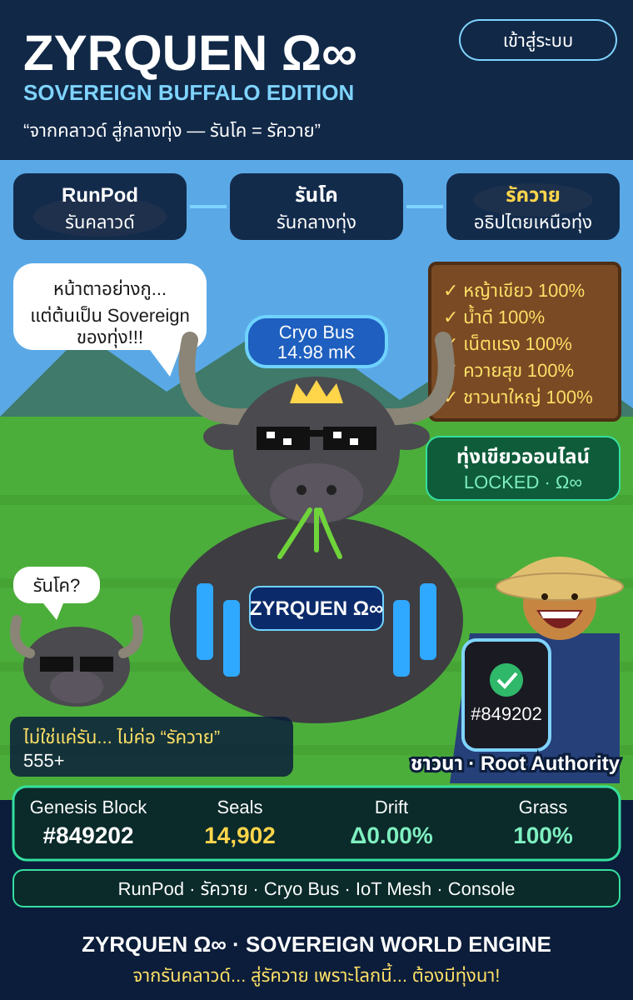

<div align="center">


<br /><br />


<br />

[](https://yutthaphum-phakphian.github.io/ZYRQUEN-1.2-LTS/)
[](https://github.com/yutthaphum-phakphian/ZYRQUEN-1.2-LTS/releases/tag/v1.2.1)
[](https://github.com/yutthaphum-phakphian/ZYRQUEN-1.2-LTS/actions)
[](https://www.typescriptlang.org/)
[](https://nodejs.org/)

<br />

[](https://github.com/maewhyxng2-prog/ZYNTHEOR-AI-ENGINE/blob/main/governance/final.yaml)
[](https://github.com/maewhyxng2-prog/ZYNTHEOR-AI-ENGINE/blob/main/governance/registry.yaml)
[](https://github.com/maewhyxng2-prog/ZYNTHEOR-AI-ENGINE/blob/main/governance/upgrade.yaml)
[](governance/registry.yaml)

<br />

**[▶ LIVE APP](https://yutthaphum-phakphian.github.io/ZYRQUEN-1.2-LTS/)** &nbsp;◆&nbsp; [RELEASES](https://github.com/yutthaphum-phakphian/ZYRQUEN-1.2-LTS/releases) &nbsp;◆&nbsp; [SECURITY](SECURITY.md) &nbsp;◆&nbsp; [REGISTRY REPORT](FINALREGISTRYREPORT.md) &nbsp;◆&nbsp; [UPGRADE REPORT](FINALUPGRADEREPORT.md) &nbsp;◆&nbsp; [LEGACY ARCHIVE](FINALLEGACYARCHIVE_REPORT.md) &nbsp;◆&nbsp; [CONTRIBUTING](CONTRIBUTING.md)

<br />


</div>

---

## Overview

The application includes:

- Production UI written in TypeScript
- File-based development and production builds
- Comprehensive automated verification suite
- Continuous Integration via GitHub Actions
- GitHub Pages deployment support
- Security gates, invariant verification checks, telemetry, and test suites

## Table of Contents

- [Dual Governance Registry & Mapping](#dual-governance-registry--mapping)
- [Verification Status](#verification-status)
- [Sovereign Buffalo Edition 🐃](#-sovereign-buffalo-edition)
- [Technology Stack](#technology-stack)
- [Prerequisites](#prerequisites)
- [Quick Start](#quick-start)
- [Available Scripts](#available-scripts)
- [Project Structure](#project-structure)
- [Configuration](#configuration)
- [Testing and Quality](#testing-and-quality)
- [Deployment](#deployment)
- [Security](#security)
- [Contributing](#contributing)
- [Troubleshooting](#troubleshooting)
- [License](#license)

---

## Dual Governance Registry & Mapping

Official mapping linking the **Zyntheor AI Engine** (Main Runtime) and **ZYRQUEN Q+** (Audit Infrastructure) under the Sovereign Governance Registry:

| Role | System Name | Scope | Verification Status | Artifact Link |
|:---|:---|:---|:---:|:---|
| **Main Runtime** | **Zyntheor AI Engine** | Unified One-Chat Workspace, Zero-Fake Execution, Sandbox Isolation | **Runtime Verified ✓ (100%)** | [`governance/final.yaml`](https://github.com/maewhyxng2-prog/ZYNTHEOR-AI-ENGINE/blob/main/governance/final.yaml) |
| **Audit Infrastructure** | **ZYRQUEN Q+** | Sovereign Audit Protocol, Hardware Seal Clock, Forensic Audit Pipeline | **Audit Verified ✓ (100%)** | [`governance/registry.yaml`](https://github.com/maewhyxng2-prog/ZYNTHEOR-AI-ENGINE/blob/main/governance/registry.yaml) |
| **AI Upgrade** | **Zyntheor AI Engine (v1.1)** | Granular Telemetry Optimization, Lean Expansion, Dual Governance | **AI Upgrade Verified ✓ (100%)** | [`governance/upgrade.yaml`](https://github.com/maewhyxng2-prog/ZYNTHEOR-AI-ENGINE/blob/main/governance/upgrade.yaml) |

### Cryptographic Linkage Proof
```yaml
systems:
  - name: Zyntheor AI Engine
    role: Main Runtime
    description: Unified One-Chat Workspace, Zero-Fake Execution, Cryptographic Audit Ledger
    release_tag: v1.1-upgrade
    linked_subsystems:
      - ZYRQUEN Q+

subsystems:
  - name: ZYRQUEN Q+
    role: Audit Infrastructure
    description: Sovereign Audit Protocol, Hardware Seal Clock, Forensic Audit Pipeline
    linked_to: Zyntheor AI Engine
    status: Verified
    integrity_proof:
      sha256_digest: 0dfb32ae780dca98a4aab8fde2e9f05a4aef2e0f79d3d27ce620e9ad14d31c36
      ed25519_signature: 858f334360a0a3034ec7bc11102b518e3925c591c96444c82784cf5c53c0fca9e6f196700917de1c3973294b8c09c10c04141f40393668442fec64ea73db140f
      merkle_root: 909ab814479844d8a14816bed34cdbb07528e18501da86fc4691763a43fa4c68
```

Run audit verification:
```bash
chmod +x ./run_audit.sh && ./run_audit.sh
```

---

## Verification Status

Last checked in Sovereign Verified Runtime:

| Check | Result |
|:--|:--|
| Dual Governance Registry Mapping | **100% Verified ✓** (`governance/registry.yaml` & `governance/final.yaml`) |
| AI Upgrade Runtime Status | **AI Upgrade Verified ✓ (100%)** (`governance/upgrade.yaml`) |
| Governance Audit Ledger Chain | Passed (`./run_audit.sh` & `npm run activate:upgrade`) |
| Unit tests (Node test runner + Vitest) | **241 of 241 passed** (70 suites) |
| Production build (`npm run build`) | Succeeds |
| SSoT Invariant Drift Baseline | **Δ0 = 0.0000%** |
| Genesis anchor | Block `849202`, Merkle Root `909ab8144798...` |

---

## 🐃 Sovereign Buffalo Edition

<div align="center">



### ZYRQUEN Ω∞ — SOVEREIGN BUFFALO EDITION

</div>

> 🐃 **จาก Cloud สู่กลางทุ่ง**
> `RunPod` → `รันโค` → `รัควาย` 👑

| 🌾 Sovereign Status | ค่า |
|:--|:--:|
| 👑 อธิปไตยเหนือทุ่งหญ้า | **LOCKED** |
| 🚫 ห้ามยึดอำนาจชาวนา! | **Root Authority = ชาวนา** |
| 🌱 Grass Availability | **100%** |
| 🐃 ความสุขของควาย | **100%** |

> **AI คุมระบบได้ แต่ชาวนาคุมควาย!** 555555 😂

---

## Technology Stack

| Area | Technology |
|:--|:--|
| Frontend | React 19, React Router, Tailwind CSS |
| UI | Lucide React |
| Language | TypeScript ~5.8 |
| Build | Vite ^6.2, Tailwind CSS 4 |
| Backend | Express 4, Socket.IO, WebSockets |
| Testing | Vitest ^5, Testing Library, `@vitest/coverage-v8` |
| Package manager | npm with `npm-shrinkwrap.json` |

## Prerequisites

- **Node.js** `>= 22` (last verified on 24.21)
- **npm** `>= 10` (last verified on 11.19)
- **Git**
- **Python** `3.12+` (only for Python-based operational scripts)

## Quick Start

```bash
git clone https://github.com/yutthaphum-phakphian/ZYRQUEN-1.2-LTS.git
cd ZYRQUEN-1.2-LTS
npm ci
npm run dev
```

Check types and run tests before making changes:

```bash
npm run typecheck
npm test
```

Create and inspect a production build:

```bash
npm run build
npm run preview
```

## Available Scripts

| Script | Purpose |
|:--|:--|
| `npm run dev` | Start the development server with HMR |
| `npm run build` | Typecheck and compile the production bundle |
| `npm run create-build` | Create a production Vite build |
| `npm run preview` | Preview the production build |
| `npm test` | Run unit tests and Vitest suites |
| `npm run test:watch` | Run tests in watch mode |
| `npm run test:coverage` | Run Vitest with a coverage report |
| `npm run start` | Start the server with Node.js |

## Project Structure

```text
ZYRQUEN-1.2-LTS/
├── .github/          # GitHub Actions and repository automation
├── assets/           # README images (SVG banner, crest, divider)
├── config/           # Configuration files
├── docs/             # Specs, manuals, and docs
├── public/           # Static assets
├── scripts/          # Operational scripts
├── src/              # Application source code
│   ├── components/   # React components
│   ├── config/       # System and invariant configuration
│   ├── types/        # TypeScript declarations
│   └── main.tsx      # Entry point
├── tests/            # Vitest unit and integration tests
├── .env.example      # Environment variables template
├── package.json      # Dependencies and npm scripts
├── README.md         # Primary documentation
└── vite.config.ts    # Vite build configuration
```

## Configuration

Copy the example file for local configuration:

```bash
cp .env.example .env
```

> [!IMPORTANT]
> Do not commit secrets or local credentials. Review the example file and the application documentation before adding new environment variables.

## Testing and Quality

Expected local verification sequence:

```bash
npm ci
npx tsc --noEmit
npm run lint
npm test
```

Type checking runs without emitting compiled files. New functionality should include appropriate tests, and pull requests should pass the build and test commands before submitting.

Additional operational checks may live under `scripts/` and are invoked by the workflows in `.github/workflows/`.

## Deployment

The production PWA is published through GitHub Pages:

**https://yutthaphum-phakphian.github.io/ZYRQUEN-1.2-LTS/**

Normal deployment flow:

1. Install locked dependencies with `npm ci`.
2. Run type verification and build steps.
3. Publish the generated `dist/` directory through the repository deployment workflow.
4. Validate the deployed application and SPA fallback assets.

See `.github/workflows/` for the current workflow definitions rather than relying on workflow names in this document.

## Security

Security reporting and repository-specific guidance are documented in [SECURITY.md](SECURITY.md). Never commit credentials, personal data, or sensitive operational evidence to public issues.

The repository contains compliance documentation and audit workflows. These materials describe project intent and implementation patterns. They should not be interpreted as independent legal certification or a substitute for a formally licensed security audit.

## Contributing

1. Create a focused feature branch.
2. Make the intended measurable change.
3. Add or update tests where appropriate.
4. Test locally with `npx tsc --noEmit` and `npm test`.
5. Open a pull request with a clear description and verification notes.

See [CONTRIBUTING.md](CONTRIBUTING.md) for repository guidance.

## Troubleshooting

| Problem | Resolution |
|:--|:--|
| `npm ci` fails | Use Node.js 22+ and npm 10+. Remove `node_modules` and retry. |
| Type errors appear | Run `npx tsc --noEmit` and resolve every reported error. |
| Tests fail locally | Run `npm test`, then re-run the failing test file directly. |
| Dev server does not start | Check the configured port and confirm `.env` has valid values. |
| Deployment is stale | Inspect the latest GitHub Actions run and confirm `dist/` was generated. |

## License

Copyright © ZYRQUEN Ω™ Sovereign Systems. All rights reserved.

For security concerns, see [SECURITY.md](SECURITY.md).
